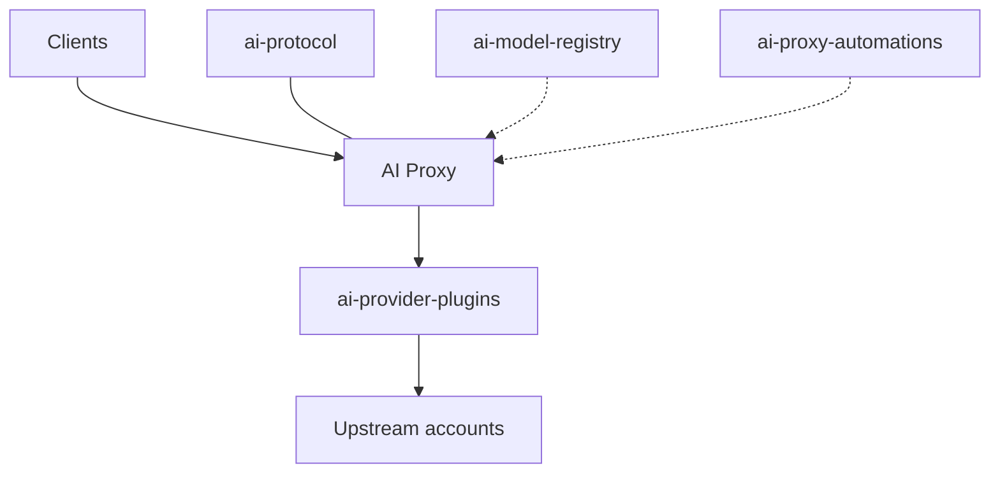

<div align="center">

# Hi, I'm Eric 👋

**Independent developer · Building with AI, shipping across the stack**


[](https://github.com/veildawn?tab=followers)
[](https://github.com/veildawn)


**English** · [简体中文](./README.zh-CN.md)

</div>

---

## 🧭 How I work

I build almost everything with AI coding agents (Cursor, Claude Code, Codex, Kiro, and friends) as my team.
My job is the architecture, the protocols, and the review. The agents handle most of the typing.
That is how one person ships the gateway, the wire-format library, the Wasm plugins, a desktop client, and an Android app.

## 🚀 AI Proxy

A self-hosted gateway. Put provider accounts in a pool, share one endpoint, and see who used what, what it cost, and which account is down. One binary, one port.



Clients talk only to the gateway. Signed Wasm provider plugins talk to upstream accounts. [ai-protocol](https://github.com/veildawn/ai-protocol) converts request, response, and SSE bodies and does no network I/O of its own. [ai-model-registry](https://github.com/veildawn/ai-model-registry) syncs model and price data into the gateway. [ai-proxy-automations](https://github.com/veildawn/ai-proxy-automations) runs scheduled Wasm jobs beside it. [ai-proxy-releases](https://github.com/veildawn/ai-proxy-releases) and [homebrew-tap](https://github.com/veildawn/homebrew-tap) ship the binary.

### What the gateway does

- Point the usual clients at one address. Streaming, tool calls, images, and thinking or reasoning pass through. If a field cannot be translated, the call errors. Nothing is dropped quietly.
- Codex, Claude, xAI, Kiro, Kimi, and Cursor sign in through the browser, or with a pasted token. Other compatible upstreams, including DeepSeek, Zhipu, and local models, are added in the admin UI.
- Route a model by name or prefix, and rewrite it to the id the upstream expects.
- Accounts take turns. A conversation sticks to the same account when it can. If one account fails, another picks up. Each account has its own concurrency cap and can use its own outbound proxy.
- Users, API keys, and plans: daily, weekly, and fixed-window quotas, plus a monthly budget. Open registration, or invite codes only.
- Built-in prices refresh on startup. Custom prices stay put. Usage and spend show up in the admin panel.
- An upgrade migrates the database. A schema mismatch refuses to start. Optional Redis covers quotas and OAuth refresh locks. The admin panel can self-update, except on the Homebrew install, where brew owns the binary.
- Chinese and English UI, light and dark.

| Port | What for |
| --- | --- |
| 8080 | API and admin panel |
| 1455 | Codex OAuth callback |
| 54545 | Anthropic OAuth callback |

The OAuth ports only need to reach the browser used to link accounts.

```sh
ai-proxy-service serve   --config config.yaml
ai-proxy-service migrate --config config.yaml
ai-proxy-service oauth login --provider codex|anthropic|xai
ai-proxy-service version
```

### Pieces

#### [ai-proxy-releases](https://github.com/veildawn/ai-proxy-releases)

[](https://github.com/veildawn/ai-proxy-releases)
[](https://github.com/veildawn/ai-proxy-releases/releases)

Packaged archives, `install.sh`, Docker Compose, `env.example`, and `checksums.txt`. The latest release builds five archives: macOS amd64, macOS arm64, Linux amd64, Linux arm64, and Windows amd64.

#### [ai-protocol](https://github.com/veildawn/ai-protocol)

[](https://github.com/veildawn/ai-protocol)
[](https://github.com/veildawn/ai-protocol/releases)

Dependency-free Go library (MIT, Go 1.23+). Pure functions over bytes. No third-party modules, no I/O, no network. A same-dialect call returns the original bytes.

| Dialect | Wire |
| --- | --- |
| `chat` | OpenAI Chat Completions (`/v1/chat/completions`) |
| `messages` | Anthropic Messages (`/v1/messages`) |
| `responses` | OpenAI Responses (`/v1/responses`) |
| `gemini` | `generateContent` (`contents` / `parts`, `candidates`) |
| `images` | Image generation (`prompt` / `n` / `size`, `b64_json`) |

The four text dialects convert request, response, and SSE in any direction. `images` pairs with `gemini` only, on bodies, not streams. Losses are named (`BodyLosses`, `StaticLosses`) instead of being dropped silently. Mapping semantics are checked against LiteLLM v1.100.1.

```sh
go get github.com/veildawn/ai-protocol@latest
```

#### [ai-model-registry](https://github.com/veildawn/ai-model-registry)

[](https://github.com/veildawn/ai-model-registry)

Provider, model, and pricing registry. Prices are keyed by provider and model, so the same model id can cost a different amount at each provider. Consumers read one signed `all.json` over HTTP (startup, hourly, and on demand) and reject the bundle when the signature does not verify. The offline fallback is the same files embedded in the Go module.

Provider ids in `index.json`: `anthropic`, `antigravity`, `ark`, `bedrock`, `cline`, `codex`, `deepseek`, `gemini`, `glm`, `kimi`, `kiro`, `mimo`, `minimax`, `ollama`, `opencode`, `opencode-go`, `qianwen`, `qoder`, `qoder-intl`, `sensenova`, `siliconflow`, `stepfun`, `tokenhub`, `typesafe`, `vercel`, `workbuddy`, `xai`.

#### [ai-provider-plugins](https://github.com/veildawn/ai-provider-plugins)

[](https://github.com/veildawn/ai-provider-plugins)

Marketplace of signed Wasm integration plugins: latest manifest, an append-only version archive, publisher keys, and a revocation list. A server installs the newest release its own build can run. `make check` verifies schemas, the version index, and publisher signatures.

English names in `index.json`: AgentJev, Antigravity, AWS Bedrock, Cerebras, Claude, Cline, CommandCode, Cursor, DashScope, DeepSeek, Devin, Gemini API, Gemini App, GLM Coding & Start Plan, Groq, Kimi, Kiro, MiMo Desktop, MiMo Token Plan, MiniMax Token Plan, Ollama, OpenAI, OpenAI Codex, OpenCode Free, OpenCode Go, OpenCode Zen, OpenRouter, Perplexity, Qianwen Token Plan, Qoder CN, Qoder International, SenseNova Token Plan, SiliconFlow, StepFun, StepFun International, Tencent Cloud TokenHub, TypeSafe, Vercel AI Gateway, Volcengine Ark, WorkBuddy, WorkBuddy International, xAI.

#### [ai-proxy-automations](https://github.com/veildawn/ai-proxy-automations)

[](https://github.com/veildawn/ai-proxy-automations)

Signed Wasm jobs for the gateway. The published plugin is **Ops Notifier**: multi-channel account-health alerts and a daily operational digest. Its manifest schedules an alert sweep every 10 minutes (`*/10 * * * *`) and a daily digest on `0 9 * * *`. The developer guide covers quota polling, prompt rewriting, protocol interception, and health alerts, compiled with Rust or TinyGo.

#### [homebrew-tap](https://github.com/veildawn/homebrew-tap)

[](https://github.com/veildawn/homebrew-tap)

Homebrew formula for the gateway. The release workflow regenerates it, and startup runs migrations.

```sh
brew install veildawn/tap/ai-proxy-service
```

### Quick start

**Linux, amd64 or arm64.** The script downloads a release, checks `checksums.txt`, and installs a systemd service. It generates secrets on first start. PostgreSQL has to be reachable.

```sh
curl -fsSL https://github.com/veildawn/ai-proxy-releases/releases/latest/download/install.sh | sudo bash
```

**Homebrew, macOS and Linux.** Files live in `$(brew --prefix)/var/ai-proxy-service`. Point `database.dsn` or `DATABASE_URL` at PostgreSQL, or MySQL 8.0.13+.

```sh
brew install veildawn/tap/ai-proxy-service
brew services start ai-proxy-service
```

**Docker Compose.** Brings its own PostgreSQL. You only pick the database password.

```sh
curl -fsSL https://github.com/veildawn/ai-proxy-releases/releases/latest/download/docker-compose.yml -o docker-compose.yml
printf 'POSTGRES_PASSWORD=%s\n' "$(openssl rand -hex 24)" > .env
docker compose up -d
```

Then open `http://localhost:8080/setup` and paste the one-time setup token printed on first start. When the admin account exists, the token is gone.

## 🌊 Also built

### [Conflux](https://github.com/veildawn/conflux-app)

[](https://github.com/veildawn/conflux-app)
[](https://github.com/veildawn/conflux-app/releases)

Cross-platform desktop client on the Mihomo core (Tauri 2, React, Tailwind CSS, Rust). GPL-3.0. It does not ship nodes or subscriptions. You bring the configuration.

- Rust and Tauri 2, with a React interface
- Traffic stats, connection management, and speed tests
- Rule lists with drag-and-drop ordering
- Remote subscriptions, local import, auto-update, and a built-in Sub-Store
- TUN mode

macOS (`.dmg`) and Windows (`.msi` / `.exe`), or:

```bash
brew tap veildawn/cask
brew install --cask conflux
```

Site: [conflux.veildawn.com](https://conflux.veildawn.com/)

### [Cross Rules](https://github.com/veildawn/cross-rules)

[](https://github.com/veildawn/cross-rules)

Mihomo rule lists: AI sites (separate from Claude), developer sites, international DNS, LAN, media, entertainment, social, and Web3, plus per-service streaming lists for Netflix, Disney+ / Hulu / ESPN+, YouTube / YouTube Music, Spotify, TikTok, HBO Max / Max, Prime Video, Apple TV+, Twitch, and Bilibili International.

```yaml
rule-providers:
  claude:
    type: http
    behavior: classical
    url: "https://raw.githubusercontent.com/veildawn/cross-rules/main/mihomo/claude.list"
    path: ./ruleset/claude.list
    interval: 86400
```

### [homebrew-cask](https://github.com/veildawn/homebrew-cask)

[](https://github.com/veildawn/homebrew-cask)

Casks for Conflux and for Mirage, an Android device mirror and control tool powered by scrcpy.

```bash
brew tap veildawn/cask
brew install --cask conflux
brew install --cask mirage
```

### [dsh-plugins](https://github.com/veildawn/dsh-plugins)

[](https://github.com/veildawn/dsh-plugins)

Community plugins for DeepSeek Harness. Each plugin is versioned, tested, and released on its own. Packages are on npm under `@weniatall`. `dsh-ai-proxy` points the host at the AI Proxy gateway (Chat Completions, Anthropic Messages, and Responses, with OAuth 2.0 PKCE).

| Plugin | What it does |
| --- | --- |
| `dsh-plugin-manager` | Install, update, and browse the catalog |
| `dsh-model-roles` | Role routing, a vision sub-agent, plan mode, and `/advisor` |
| `dsh-remote-control` | Remote and LAN access with token auth |
| `dsh-ai-proxy` | Gateway connector for the three wire formats above |
| `dsh-mobile-adapter` | Phone-browser layout, uploads, and fullscreen |
| `dsh-file-viewer` | Workspace files, including Markdown, PDF, Office, and images |
| `dsh-archive-manager` | Archive, restore, and delete sessions |
| `dsh-prompt-history` | Edit and resend prompts, synced across devices |
| `dsh-theme-studio` | Built-in themes, colors, fonts, and backgrounds |
| `dsh-jev` | Decision-model tools, including TypeSafe Jev |
| `dsh-image-gen` | Text-to-image as a native tool |
| `dsh-task-models` | Choose a sub-agent model per task type |
| `dsh-im-bot` | WeCom smart bot and personal WeChat, both ways |
| `dsh-system-prompt-editor` | Edit the live system prompt, with a preview |
| `dsh-repo-wiki` | Two-phase repo wiki written to `.dsh/repowiki` |
| `dsh-spec` | Kiro-compatible spec mode: requirements, design, and tasks |

`dsh-terminal` and `dsh-zcode-theme` are deprecated. The manager can uninstall them and will not install or update them. The ZCode themes live in `dsh-theme-studio`.

```bash
dsh plugin --profile web add @weniatall/dsh-plugin-manager
```

### [conflux-code](https://github.com/veildawn/conflux-code)

[](https://github.com/veildawn/conflux-code)

Android project (Kotlin). The app label is Claude Mobile. It bootstraps an embedded Linux environment for the Claude CLI, with `feature-chat`, `feature-sessions`, and `feature-settings` modules, and a foreground service that keeps the CLI process alive.

### [builder](https://github.com/veildawn/builder)

[](https://github.com/veildawn/builder)

GitHub Actions workflows for release builds. The Mirage workflow builds macOS DMGs (Intel and Apple silicon) and a Windows NSIS installer, then publishes the cask release on [homebrew-cask](https://github.com/veildawn/homebrew-cask). A second workflow builds an Android APK.

### [Dead-Silence](https://github.com/veildawn/Dead-Silence)

[](https://github.com/veildawn/Dead-Silence)

Public notes for a 10-episode short, 《死寂边境》. The overview gives the English title as Dead Frontier and treats the folder name Dead-Silence as temporary. The repo holds the outline, character notes, poster prompts, a trailer description, and storyboards.

## 🛠️ Stack


<div align="center">


</div>
