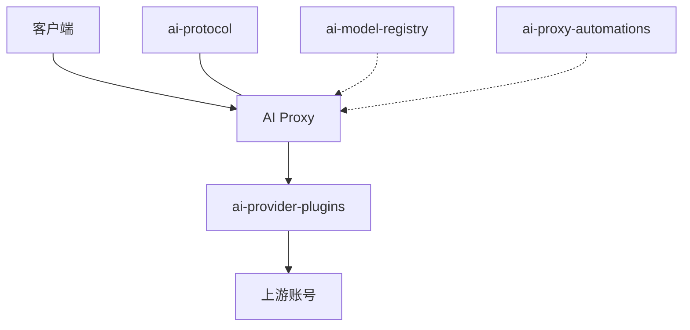

<div align="center">

# 你好，我是 Eric 👋

**独立开发者 · 与 AI 一起构建，全栈交付**


[](https://github.com/veildawn?tab=followers)
[](https://github.com/veildawn)

[English](./README.md) · **简体中文**

</div>

---

## 🧭 我的工作方式

我几乎所有代码都交给 AI 编码代理来写（Cursor、Claude Code、Codex、Kiro 等），它们就是我的团队。
我负责架构、协议设计和代码评审，大部分敲代码的活由代理完成。
一个人因此能交付网关、线路格式库、Wasm 插件、桌面客户端和 Android 应用。

## 🚀 AI Proxy

可自托管的网关。把服务商账号放进一个池，共用一个端点，就能看到谁在用、花了多少、哪个账号挂了。一个二进制，一个端口。



客户端只连接网关。签名过的 Wasm 服务商插件去连接上游账号。[ai-protocol](https://github.com/veildawn/ai-protocol) 转换请求、响应和 SSE，自身不做任何网络 I/O。[ai-model-registry](https://github.com/veildawn/ai-model-registry) 把模型和价格同步进网关。[ai-proxy-automations](https://github.com/veildawn/ai-proxy-automations) 在旁边跑按计划执行的 Wasm 任务。[ai-proxy-releases](https://github.com/veildawn/ai-proxy-releases) 和 [homebrew-tap](https://github.com/veildawn/homebrew-tap) 负责发布二进制。

### 网关能做什么

- 把常用客户端指到同一个地址。流式输出、工具调用、图片、思考或推理都会透传。某个字段翻译不了，这次调用就报错，不会悄悄丢掉。
- Codex、Claude、xAI、Kiro、Kimi、Cursor 可以用浏览器登录，也可以粘贴令牌。其他兼容的上游，包括 DeepSeek、智谱和本地模型，在管理界面里添加。
- 按模型名或前缀路由，并改写成上游真正接受的 id。
- 账号轮流使用。同一段对话能粘在同一个账号上就粘住。一个账号失败，另一个接上。每个账号有自己的并发上限，也可以走自己的出站代理。
- 用户、API 密钥和套餐：按日、按周、固定窗口的配额，再加上每月预算。可以开放注册，也可以只允许邀请码。
- 内置价格在启动时刷新，自定义价格保持不动。用量和花费在管理面板里看。
- 升级会自动迁移数据库。模式对不上就拒绝启动。可选 Redis，用来做配额和 OAuth 刷新锁。管理面板可以一键自更新；Homebrew 安装除外，二进制归 brew 管。
- 中英界面，浅色和深色主题。

| 端口 | 用途 |
| --- | --- |
| 8080 | API 和管理面板 |
| 1455 | Codex OAuth 回调 |
| 54545 | Anthropic OAuth 回调 |

OAuth 端口只需要能到达用来绑定账号的那台浏览器。

```sh
ai-proxy-service serve   --config config.yaml
ai-proxy-service migrate --config config.yaml
ai-proxy-service oauth login --provider codex|anthropic|xai
ai-proxy-service version
```

### 各部分

#### [ai-proxy-releases](https://github.com/veildawn/ai-proxy-releases)

[](https://github.com/veildawn/ai-proxy-releases)
[](https://github.com/veildawn/ai-proxy-releases/releases)

打包好的压缩包、`install.sh`、Docker Compose、`env.example` 和 `checksums.txt`。最新发布包含五个归档：macOS amd64、macOS arm64、Linux amd64、Linux arm64、Windows amd64。

#### [ai-protocol](https://github.com/veildawn/ai-protocol)

[](https://github.com/veildawn/ai-protocol)
[](https://github.com/veildawn/ai-protocol/releases)

零依赖的 Go 库（MIT，Go 1.23+）。对字节做纯函数转换。没有第三方模块，没有 I/O，没有网络。同一方言的调用原样返回原始字节。

| 方言 | 线路 |
| --- | --- |
| `chat` | OpenAI Chat Completions（`/v1/chat/completions`） |
| `messages` | Anthropic Messages（`/v1/messages`） |
| `responses` | OpenAI Responses（`/v1/responses`） |
| `gemini` | `generateContent`（`contents` / `parts`、`candidates`） |
| `images` | 图像生成（`prompt` / `n` / `size`、`b64_json`） |

四种文本方言可以在任意方向上转换请求、响应和 SSE。`images` 只和 `gemini` 配对，而且只转换正文，不转换流。丢失的字段会具名标出（`BodyLosses`、`StaticLosses`），而不是悄悄丢掉。映射语义对照 LiteLLM v1.100.1 校验。

```sh
go get github.com/veildawn/ai-protocol@latest
```

#### [ai-model-registry](https://github.com/veildawn/ai-model-registry)

[](https://github.com/veildawn/ai-model-registry)

服务商、模型和价格注册表。价格按（服务商，模型）索引，同一个模型 id 在不同服务商可以有不同价格。消费方通过 HTTP 读取一份签名过的 `all.json`（启动时、每小时、以及按需），签名验证失败就拒绝这份数据。离线回退是嵌进 Go 模块的同一批文件。

`index.json` 里的服务商 id：`anthropic`、`antigravity`、`ark`、`bedrock`、`cline`、`codex`、`deepseek`、`gemini`、`glm`、`kimi`、`kiro`、`mimo`、`minimax`、`ollama`、`opencode`、`opencode-go`、`qianwen`、`qoder`、`qoder-intl`、`sensenova`、`siliconflow`、`stepfun`、`tokenhub`、`typesafe`、`vercel`、`workbuddy`、`xai`。

#### [ai-provider-plugins](https://github.com/veildawn/ai-provider-plugins)

[](https://github.com/veildawn/ai-provider-plugins)

签名 Wasm 集成插件市场：最新清单、只追加的版本归档、发布者公钥和吊销列表。服务端会安装自身构建能够运行的最新版本。`make check` 会校验 JSON schema、版本索引和发布者签名。

`index.json` 中的英文名称：AgentJev、Antigravity、AWS Bedrock、Cerebras、Claude、Cline、CommandCode、Cursor、DashScope、DeepSeek、Devin、Gemini API、Gemini App、GLM Coding & Start Plan、Groq、Kimi、Kiro、MiMo Desktop、MiMo Token Plan、MiniMax Token Plan、Ollama、OpenAI、OpenAI Codex、OpenCode Free、OpenCode Go、OpenCode Zen、OpenRouter、Perplexity、Qianwen Token Plan、Qoder CN、Qoder International、SenseNova Token Plan、SiliconFlow、StepFun、StepFun International、Tencent Cloud TokenHub、TypeSafe、Vercel AI Gateway、Volcengine Ark、WorkBuddy、WorkBuddy International、xAI。

#### [ai-proxy-automations](https://github.com/veildawn/ai-proxy-automations)

[](https://github.com/veildawn/ai-proxy-automations)

网关的签名 Wasm 任务。已经发布的插件是 **Ops Notifier（运维通知助手）**：多渠道账号健康告警，以及每日运营摘要。清单里的告警巡检是 `*/10 * * * *`，每日摘要是 `0 9 * * *`。开发手册覆盖配额查询、提示词改写、协议拦截和健康告警，可用 Rust 或 TinyGo 编译。

#### [homebrew-tap](https://github.com/veildawn/homebrew-tap)

[](https://github.com/veildawn/homebrew-tap)

网关的 Homebrew formula。发布流程会重新生成它，启动时会跑数据库迁移。

```sh
brew install veildawn/tap/ai-proxy-service
```

### 快速开始

**Linux，amd64 或 arm64。** 脚本下载发布包，校验 `checksums.txt`，并安装 systemd 服务。密钥在首次启动时生成。需要能连上 PostgreSQL。

```sh
curl -fsSL https://github.com/veildawn/ai-proxy-releases/releases/latest/download/install.sh | sudo bash
```

**Homebrew，macOS 和 Linux。** 文件放在 `$(brew --prefix)/var/ai-proxy-service`。把 `database.dsn` 或 `DATABASE_URL` 指到 PostgreSQL，或 MySQL 8.0.13+。

```sh
brew install veildawn/tap/ai-proxy-service
brew services start ai-proxy-service
```

**Docker Compose。** 自带 PostgreSQL。只需要自己定数据库密码。

```sh
curl -fsSL https://github.com/veildawn/ai-proxy-releases/releases/latest/download/docker-compose.yml -o docker-compose.yml
printf 'POSTGRES_PASSWORD=%s\n' "$(openssl rand -hex 24)" > .env
docker compose up -d
```

然后打开 `http://localhost:8080/setup`，粘贴首次启动时打印的一次性安装令牌。管理员账号创建之后，令牌即失效。

## 🌊 其他作品

### [Conflux](https://github.com/veildawn/conflux-app)

[](https://github.com/veildawn/conflux-app)
[](https://github.com/veildawn/conflux-app/releases)

基于 Mihomo 内核的跨平台桌面客户端（Tauri 2、React、Tailwind CSS、Rust）。GPL-3.0。软件本身不提供节点或订阅，配置由使用者自己提供。

- Rust 与 Tauri 2，界面用 React
- 流量统计、连接管理和速度测试
- 支持拖拽排序的规则列表
- 远程订阅、本地导入、自动更新，以及内置 Sub-Store
- TUN 模式

macOS（`.dmg`）和 Windows（`.msi` / `.exe`），或者：

```bash
brew tap veildawn/cask
brew install --cask conflux
```

网站：[conflux.veildawn.com](https://conflux.veildawn.com/)

### [Cross Rules](https://github.com/veildawn/cross-rules)

[](https://github.com/veildawn/cross-rules)

Mihomo 规则列表：AI 网站（与 Claude 分开）、开发者网站、国际 DNS、局域网、媒体、娱乐、社交媒体和 Web3，以及按服务拆开的流媒体列表：Netflix、Disney+ / Hulu / ESPN+、YouTube / YouTube Music、Spotify、TikTok、HBO Max / Max、Prime Video、Apple TV+、Twitch、Bilibili 国际版。

```yaml
rule-providers:
  claude:
    type: http
    behavior: classical
    url: "https://raw.githubusercontent.com/veildawn/cross-rules/main/mihomo/claude.list"
    path: ./ruleset/claude.list
    interval: 86400
```

### [homebrew-cask](https://github.com/veildawn/homebrew-cask)

[](https://github.com/veildawn/homebrew-cask)

收录 Conflux，以及 Mirage。Mirage 是基于 scrcpy 的 Android 设备镜像与控制工具。

```bash
brew tap veildawn/cask
brew install --cask conflux
brew install --cask mirage
```

### [dsh-plugins](https://github.com/veildawn/dsh-plugins)

[](https://github.com/veildawn/dsh-plugins)

DeepSeek Harness 的社区插件。每个插件独立版本、独立测试、独立发布。npm 包在 `@weniatall` 作用域下。`dsh-ai-proxy` 把宿主接到 AI Proxy 网关（Chat Completions、Anthropic Messages、Responses，以及 OAuth 2.0 PKCE）。

| 插件 | 作用 |
| --- | --- |
| `dsh-plugin-manager` | 安装、更新、浏览插件目录 |
| `dsh-model-roles` | 角色路由、识图子代理、计划模式和 `/advisor` |
| `dsh-remote-control` | 带令牌认证的远程和局域网访问 |
| `dsh-ai-proxy` | 上面三种线路格式的网关连接器 |
| `dsh-mobile-adapter` | 手机浏览器布局、上传和全屏 |
| `dsh-file-viewer` | 工作区文件，包括 Markdown、PDF、Office 和图片 |
| `dsh-archive-manager` | 归档、恢复和删除会话 |
| `dsh-prompt-history` | 修改并重发提示词，跨设备同步 |
| `dsh-theme-studio` | 内置主题，以及颜色、字体和背景 |
| `dsh-jev` | 决策模型工具，包括 TypeSafe Jev |
| `dsh-image-gen` | 把文生图做成原生工具 |
| `dsh-task-models` | 按任务类型为子代理选模型 |
| `dsh-im-bot` | 企业微信智能机器人与个人微信，双向 |
| `dsh-system-prompt-editor` | 编辑当前真实系统提示词，并带预览 |
| `dsh-repo-wiki` | 两阶段仓库知识库，写入 `.dsh/repowiki` |
| `dsh-spec` | 兼容 Kiro 的 Spec 模式：需求、设计与任务 |

`dsh-terminal` 和 `dsh-zcode-theme` 已废弃。管理器只能卸载它们，不能安装或更新。ZCode 主题已并入 `dsh-theme-studio`。

```bash
dsh plugin --profile web add @weniatall/dsh-plugin-manager
```

### [conflux-code](https://github.com/veildawn/conflux-code)

[](https://github.com/veildawn/conflux-code)

Android 项目（Kotlin）。应用名称是 Claude Mobile。它为 Claude CLI 引导一套嵌入式 Linux 环境，模块包括 `feature-chat`、`feature-sessions` 和 `feature-settings`，并用前台服务保持 CLI 进程存活。

### [builder](https://github.com/veildawn/builder)

[](https://github.com/veildawn/builder)

用来打发布包的 GitHub Actions 工作流。Mirage 工作流构建 macOS DMG（Intel 和 Apple 芯片）以及 Windows NSIS 安装包，然后把 cask 发布到 [homebrew-cask](https://github.com/veildawn/homebrew-cask)。另一个工作流构建 Android APK。

### [Dead-Silence](https://github.com/veildawn/Dead-Silence)

[](https://github.com/veildawn/Dead-Silence)

10 集短剧《死寂边境》的公开笔记。概览里的英文标题是 Dead Frontier，并写明文件夹名 Dead-Silence 是暂用名。仓库里有大纲、角色设定、海报提示词、预告片描述和分镜。

## 🛠️ 技术栈


<div align="center">


</div>
